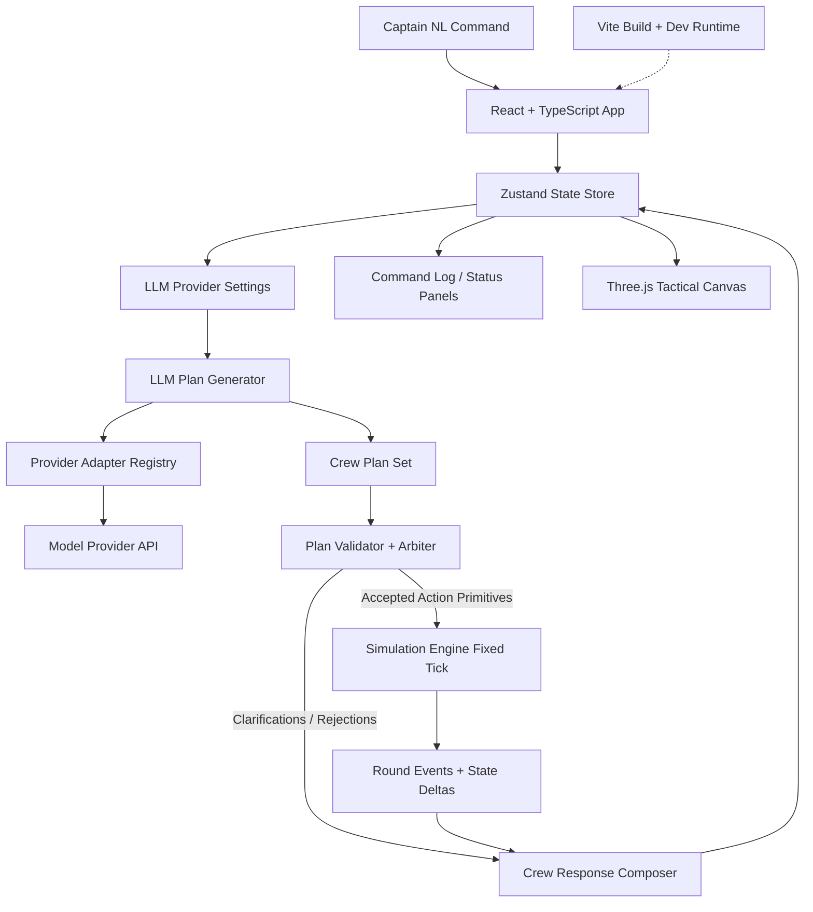

# High-Level Design: Ship Commander

## Problem

Most space-command games rely on menu-driven controls that flatten the feeling of command into UI clicks. Ship Commander aims to simulate the role of a captain commanding a science-fiction carrier-class vessel through natural-language orders to crew members. The core problem is translating ambiguous human command language into consistent, simulation-safe actions while preserving believable crew dialogue and tactical depth.

## Approach

### Plan-first command loop with simulation arbitration

Each turn, the captain issues natural-language intent. The language model produces role-scoped crew plans containing goals, ordered actions, contingencies, and rationale. A simulation governance layer validates these plans against ship state, resource constraints, and tactical rules, then arbitrates conflicts before execution. The simulation engine is the authoritative state transition system.

### Turn-based simulation and feedback

Accepted actions execute in discrete rounds. At round completion, the engine emits world updates, ship status changes, and notable events. The response layer converts these outputs into crew dialogue and command outcomes visible to the captain.

### Dual presentation model

The game UI is a command log-first experience with a mode toggle between:
1. A 3D local-space tactical view (black-and-white wireframe aesthetic).
2. A systems/status view for ship condition, crew readiness, and mission state.

### Browser-first runtime architecture

Iteration 1 runs entirely in the browser as a single-page application built with:
- **React + TypeScript** for UI composition and command-log interactions
- **Vite** for development/build pipeline
- **Zustand** for shared command/simulation/presentation state
- **Three.js** for tactical scene rendering

The initial UI shell is a single app with a canvas-primary layout. Command log and status controls render as React overlays/panels around the tactical canvas. Simulation updates run on a fixed-step tick decoupled from render frame rate.
LLM plan generation uses a pluggable provider interface selected from player settings; provider and API-key settings persist in browser local storage and are applied at dispatch time for model calls.

## Target Users

- Players who want role-centric command gameplay rather than micromanaging subsystems directly.
- Players who value emergent tactical narrative from crew interaction under uncertainty.
- Players who prefer turn-based strategic pacing over action execution.

## Goals

- Captain intent can be expressed in natural language without mandatory command syntax.
- Every simulation state transition remains valid under explicit world and systems rules.
- Crew output is tactically meaningful, role-consistent, and explainable from current game state.
- A full turn can be replayed from recorded captain input, crew plan artifacts, and simulation state deltas.
- The visual layer communicates tactical context without replacing the command log as the primary interface.

## Non-Goals

- Real-time action combat or twitch gameplay.
- Fully autonomous narrative generation detached from simulation constraints.
- Photorealistic rendering or color-rich visual style in initial versions.
- Multiplayer command coordination in the initial architecture.

## Tenets

- **Balanced authority boundary.** The LLM proposes plans, but simulation governance decides what executes.
- **Deterministic execution over deterministic planning.** Crew planning and dialogue may vary, but committed world-state transitions must be replayable.
- **Tactical depth over instant responses.** Moderate per-turn deliberation latency is acceptable when it improves plan quality and conflict resolution.
- **Browser-native first iteration.** Initial architecture prioritizes browser execution and local iteration speed over server-distributed systems.

## System Design

**Core components**

- **LLM Plan Generator**: Converts captain orders into structured, role-scoped crew plans.
- **Plan Validator + Arbiter**: Checks feasibility, resolves inter-plan conflicts, and enforces command policy.
- **Simulation Engine**: Applies accepted primitives, advances game state, and emits deterministic deltas.
- **Response Composer**: Produces crew-facing explanations and follow-up requests grounded in simulation outputs.
- **Presentation Layer**: Renders command log plus toggled tactical/status visualizations.

## Key Design Decisions

1. **Plan-first architecture over direct action extraction**  
   Structured crew plans preserve rationale and contingencies, improving arbitration and debuggability versus one-shot direct action extraction.

2. **Simulation-authoritative execution**  
   All state mutation passes through deterministic simulation rules to prevent language-model drift from corrupting game state.

3. **Log-first UX with secondary visual modes**  
   The captain's core interface remains conversational command and response; 3D and status views support situational awareness without becoming mandatory control surfaces.

4. **Single-app browser deployment for iteration 1**  
   A single React/Vite browser app minimizes operational complexity and accelerates design validation before introducing distributed runtime concerns.

5. **Zustand as shared state boundary**  
   A lightweight centralized store keeps command, simulation, and presentation state synchronized without introducing heavier state infrastructure in iteration 1.

6. **Fixed-step simulation tick decoupled from render loop**  
   Decoupling simulation progression from frame rendering preserves deterministic simulation behavior while allowing rendering to adapt to device performance.

7. **Provider-adapter dispatch over provider-specific branching**  
   A typed provider interface and adapter registry keeps model-provider API differences isolated, so adding providers does not require changing command-loop orchestration logic.

## Success Metrics

- **Execution validity**: percentage of turns with zero invalid or contradictory executed actions.
- **Clarification burden**: median number of clarification prompts per captain command.
- **Turn responsiveness**: p50/p95 turn completion latency from captain message to finalized round output.
- **Replay integrity**: percentage of sampled turns that reproduce identical simulation deltas from the same accepted action primitives.
- **Command comprehension**: player-reported rating that crew responses matched intended command outcomes.

## References

- LID workflow directive: `AGENTS.md`
